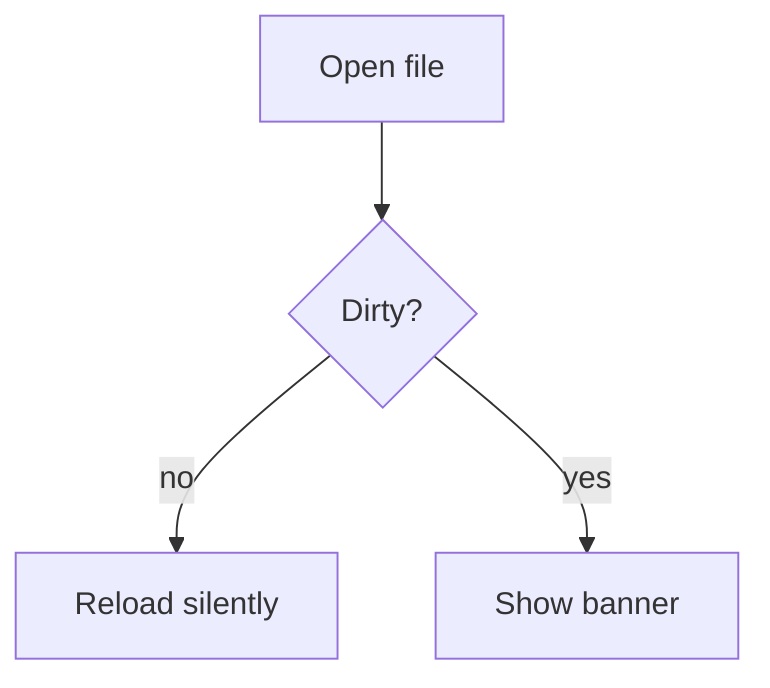
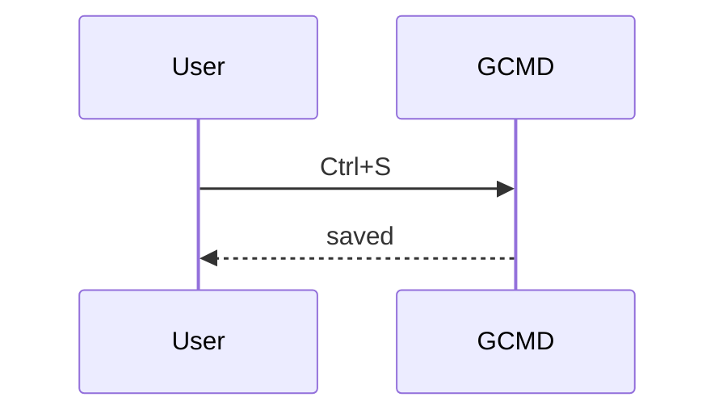

# GCMD feature sample

This document contains every construct GCMD must render. Open it after each
phase and walk through `docs/checklists/`.

## Inline formatting

Plain text with **strong**, *emphasis*, ***both***, `inline code`,
~~strikethrough~~ and a [link](https://github.github.com/gfm/ "GFM spec").
Autolinks: https://example.com and www.example.com and contact@example.com.
Escapes: \*not emphasis\*, a literal \`backtick\`, and a backslash \\.
Hard line break with two trailing spaces  
continues here. A backslash break\
also continues here.

Inline image: 

## Headings

### Level 3

#### Level 4

##### Level 5

###### Level 6

Setext heading level 1
======================

Setext heading level 2
----------------------

## Lists

- Unordered item
- Another item
  - Nested item
    - Deeply nested
- Item with a long paragraph that wraps across several lines in a narrow
  window so that soft wrapping and indentation can be checked visually.

1. Ordered item
2. Second item
   1. Nested ordered
   2. Nested ordered
3. Third item

* Star marker
+ Plus marker

## Task lists

- [ ] Open task
- [x] Done task
- [ ] Task with **formatting** and `code`
  - [x] Nested done task

## Blockquotes

> A quote with *emphasis* and a [link](https://example.com).
>
> > Nested quote.
>
> - A list inside a quote
> - Second item

## Code

Indented code block:

    const indented = true;

Fenced, labeled:

```ts
export function hello(name: string): string {
  return `Hello, ${name}`;
}
```

```python
def hello(name: str) -> str:
    return f"Hello, {name}"
```

```rust
fn main() {
    println!("Hello");
}
```

Fenced, unlabeled (auto-detect candidate):

```
#!/usr/bin/env bash
set -euo pipefail
echo "detect me"
```

Fence with tildes and an info string:

~~~json {"meta": true}
{ "key": "value", "list": [1, 2, 3] }
~~~

## Tables

| Left | Center | Right |
| :--- | :----: | ----: |
| a    |   b    |     c |
| **bold** | `code` | [link](https://example.com) |
| escaped \| pipe | long cell content that wraps | 42 |

Table without leading and trailing pipes:

Name | Value
---- | -----
one  | 1
two  | 2

## Mermaid





## Thematic breaks

---

***

___

## HTML and raw content

<details>
<summary>Raw HTML block</summary>

Content inside raw HTML.

</details>

Inline <kbd>Ctrl</kbd>+<kbd>S</kbd> html.

## Footnote-like and reference links

A reference link to [the spec][gfm] and a collapsed one [gfm][].

[gfm]: https://github.github.com/gfm/

## Local links and images

Ctrl+click opens [the plan](../../PLAN.md) in a new GCMD window and
[the GFM spec](https://github.github.com/gfm/) in the browser.
A missing image shows its alt text: 
Remote images stay as text: 

## Edge cases

Trailing spaces on the next line:    
Empty heading marker below should stay literal when not a heading:

#hashtag without space is a paragraph.

1986\. A year, not a list.

Final paragraph without trailing newline at the end of the file.